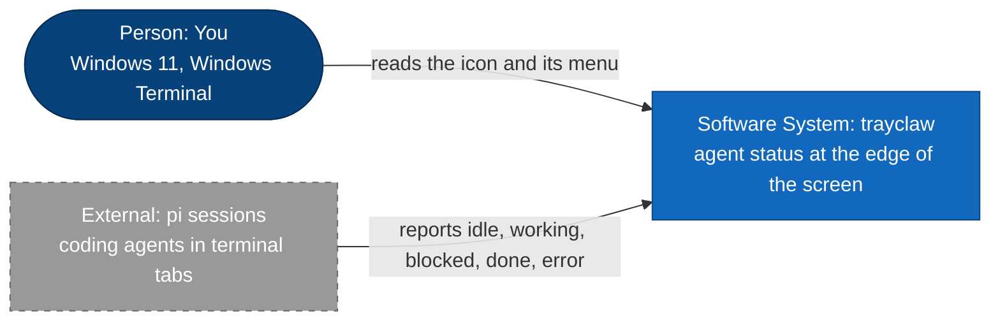
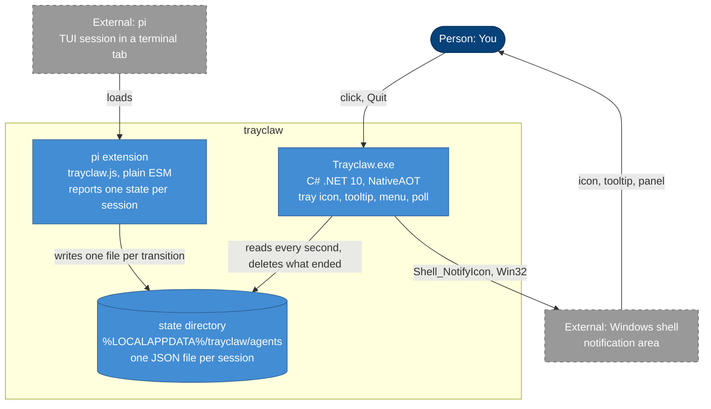

# Architecture

Last verified: 2026-11-20, after the `agent-status` change.

trayclaw is a tray icon on Windows that reports what the pi coding agents in your
terminal tabs are doing. It reads agent state; it never drives pi.

## Context

## Container

## Legend

| Shape | C4 element |
|---|---|
| `(["..."])` | person |
| `["..."]` | system or container |
| `[("...")]` | store |
| dashed `["..."]` | external system |

## Containers

| Container | Responsibility | Path | Technology |
|---|---|---|---|
| Trayclaw.exe | tray icon, tooltip, the status panel, one-second poll, liveness, aggregation | `src/Trayclaw` | C# .NET 10, NativeAOT, Win32 and GDI through P/Invoke |
| pi extension | maps pi's lifecycle events to one state per session and writes it | `extensions/trayclaw.js` | Node ESM, loaded by pi |

## Store

| Store | Holds | Path | Lifetime |
|---|---|---|---|
| state directory | one JSON file per session: pid, session id, folder, name, model, state, detail, updated time | `%LOCALAPPDATA%/trayclaw/agents` | written on every transition, removed on clean exit or by the tray once the process is gone |

## Open questions

- Which terminal tab a session belongs to. Windows Terminal exposes no handle, so
  the menu shows the working folder and session name instead.
- Whether a second agent host ever needs the same status. If so, the state
  directory stops being private to trayclaw and the contract moves.

## Decisions and behavior

- `adr/0001-native-tray-fed-by-pi-extension.md`: the stack, and why the state
  comes from pi rather than from the terminal.
- `openspec/specs/agent-status/spec.md`: the behavior a user can observe.
- `openspec/changes/archive/2026-11-20-bootstrap/design.md`: the state contract,
  field by field, as it was designed before it existed.
