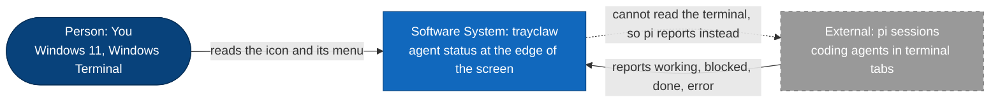
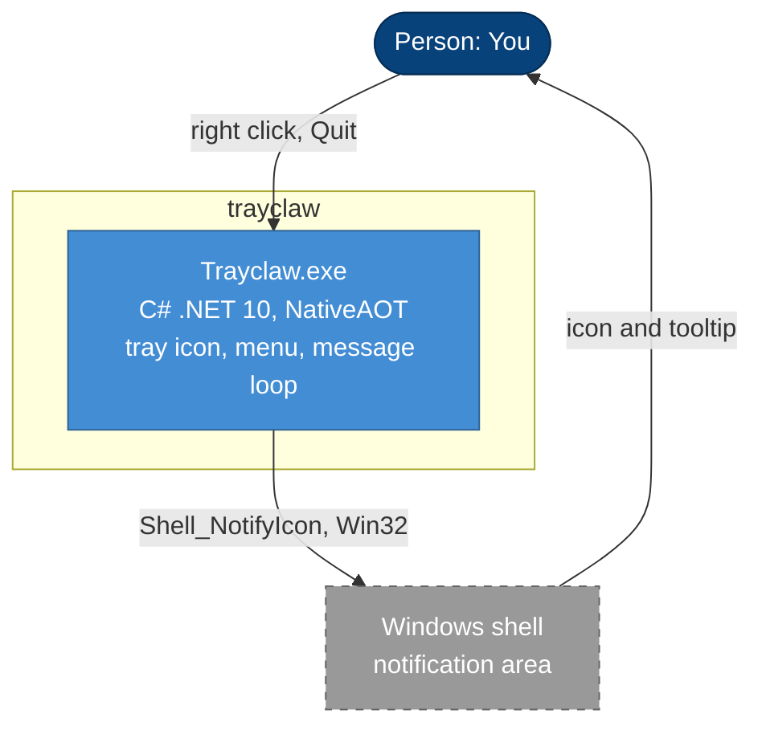

# Architecture

Last verified: 2026-11-20, at the archive of the `bootstrap` change.

trayclaw is a tray icon on Windows that reports what the pi coding agents in your
terminal tabs are doing. It reads agent state; it never drives pi.

## Context

## Container

Built today:

The next change adds the half that carries the state, as decided in
`adr/0001-native-tray-fed-by-pi-extension.md`: a pi extension inside the pi
process, and a state directory under `%LOCALAPPDATA%/trayclaw` that both sides
read and write. Neither exists in the repository yet, so they are not drawn.

## Legend

| Shape | C4 element |
|---|---|
| `(["..."])` | person |
| `["..."]` | system or container |
| `[("...")]` | store |
| dashed `["..."]` | external system |

## Containers

| Container | Responsibility | Path | Technology |
|---|---|---|---|
| Trayclaw.exe | tray icon, menu, message loop; later the state poll and the menu content | `src/Trayclaw` | C# .NET 10, NativeAOT, Win32 through P/Invoke |

## Not built yet

| Element | Responsibility | Arrives in |
|---|---|---|
| pi extension | reports `working`, `blocked`, `done`, `error`, `idle` on pi's lifecycle events | next change |
| state directory | one small JSON file per session, `%LOCALAPPDATA%/trayclaw` | next change |

## Open questions

- Which terminal tab a session belongs to. Windows Terminal exposes no handle, so
  the menu shows the working folder and session name instead.
- Whether a second agent host ever needs the same status. If so, the state
  directory stops being private to trayclaw and the contract moves.

## Decisions and behavior

- `adr/0001-native-tray-fed-by-pi-extension.md`: the stack, and why the state
  comes from pi rather than from the terminal.
- `openspec/changes/bootstrap/design.md`: the state contract, field by field.
- `openspec/specs/`: empty until the next change introduces `agent-status`.
