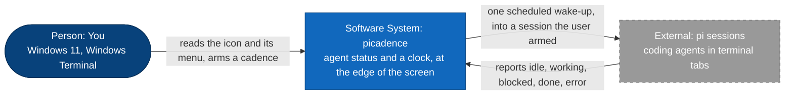
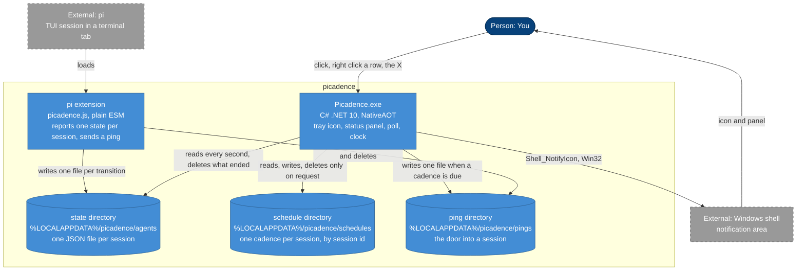

# Architecture

Last verified: 2026-11-21, after the `add-scheduled-ping` change.

picadence is a tray icon on Windows that reports what the pi coding agents in your
terminal tabs are doing, and wakes a session the user armed with a cadence. It
reads agent state, and its only other act is one file that a session already
running picks up.

## Context

## Container

## Legend

| Shape | C4 element |
|---|---|
| `(["..."])` | person |
| `["..."]` | system or container |
| `[("...")]` | store |
| dashed `["..."]` | external system |

## Containers

| Container | Responsibility | Path | Technology |
|---|---|---|---|
| Picadence.exe | tray icon, status panel, one-second poll, liveness, aggregation, the cadence clock | `src/Picadence` | C# .NET 10, NativeAOT, Win32 and GDI through P/Invoke |
| pi extension | maps pi's lifecycle events to one state per session, and turns a ping into one turn | `extensions/picadence.js` | Node ESM, loaded by pi |

## Store

| Store | Holds | Path | Lifetime |
|---|---|---|---|
| state directory | one JSON file per session: pid, session id, folder, name, model, state, detail, updated time | `%LOCALAPPDATA%/picadence/agents` | written on every transition, removed on clean exit or by the tray once the process is gone |
| schedule directory | one cadence per session id: name, folder, cadence, next time, last issued time, missed windows | `%LOCALAPPDATA%/picadence/schedules` | written when a cadence is armed or fires, removed only when the user turns it off |
| ping directory | one message per session id: the moment, the cadence, the missed count, the words | `%LOCALAPPDATA%/picadence/pings` | written when a cadence is due, deleted by the session that consumes it |

## Trust note

The tray writes in exactly one place pi looks: the ping directory. It never
writes an input stream or a keystroke, never starts or stops a session, and never
touches pi's own session storage. A wake-up reaches only a session the user
armed, and only while that session is live in a tab.

## Open questions

- Which terminal tab a session belongs to. Windows Terminal exposes no handle, so
  the menu shows the working folder and session name instead.
- Whether a second agent host ever needs the same status. If so, the state
  directory stops being private to picadence and the contract moves.

## Decisions and behavior

- `adr/0001-native-tray-fed-by-pi-extension.md`: the stack, and why the state
  comes from pi rather than from the terminal.
- `adr/0002-the-tray-may-wake-a-session.md`: why the tray may start a turn, and
  what it still may not do.
- `openspec/specs/agent-status/spec.md`: the behavior a user can observe.
- `openspec/specs/scheduled-ping/spec.md`: arming a cadence, and when it wakes a
  session.
- `openspec/changes/archive/2026-11-20-bootstrap/design.md`: the state contract,
  field by field, as it was designed before it existed.
- `openspec/changes/add-scheduled-ping/design.md`: the three lanes, the cadence
  arithmetic, and the panel flyout.
